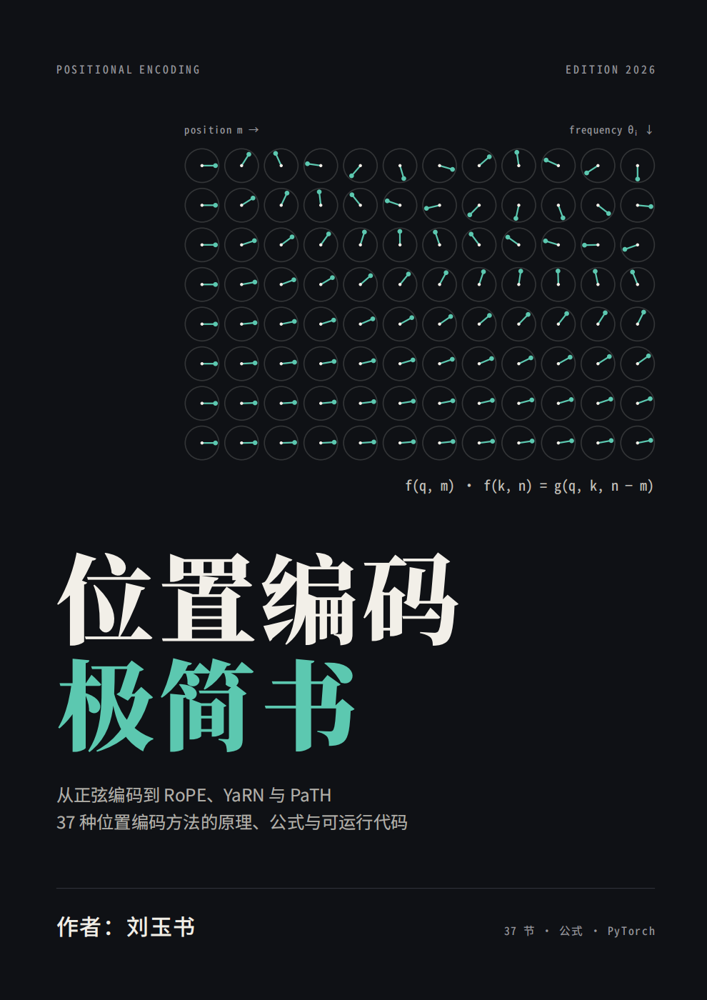

<p align="center">
  
</p>

<h1 align="center">📐 位置编码极简书</h1>

<p align="center">
  <b>从正弦编码到 PaTH —— LLM 中 37 种位置编码方法，一本搞定。</b>
</p>

<p align="center">
  
  
  
  
</p>

<p align="center">
  每种方法配：<b>一句话简介 · 核心公式 · 可运行的 PyTorch 示例</b>
</p>

---

## ✨ 为什么需要位置编码？

自注意力对输入是**置换等变**的：把 token 打乱顺序，输出只是跟着打乱，模型分不出「猫追狗」和「狗追猫」。位置编码就是把顺序信息注入模型的手段——从 2017 年原始 Transformer 的正弦编码，到 2025 年数据依赖的 PaTH，这条脉络贯穿了几乎每一代 LLM 的架构设计。

## 🎯 这本书好在哪

- 🧭 **全景地图**：37 种方法按「绝对 → 相对 → 旋转 → 扩展 → 无/混合 → 数据依赖 → 隐式」七章组织，一张图看清演进脉络。
- ⚡ **极简但可跑**：每种方法 5～15 行 PyTorch 代码，`pip install torch` 即可在 CPU 上复现核心思想，不纠缠工程细节。
- 🔬 **公式 + 直觉**：每个公式都配一句话讲清「它解决了什么、为什么有效」。
- 🆕 **追踪前沿**：覆盖到 2026 年中，包含 Llama 4 iRoPE、Gemma 3、Qwen3-VL 交错 MRoPE、DeepSeek MLA 解耦 RoPE、PaTH 等最新工作。
- 📊 **速查表收尾**：附录一张表对照全部方法的注入位置、训短测长能力与代表模型。

## 📚 内容大纲

| 章节 | 主题 | 方法数 |
|---|---|---|
| 第 0 章 | 约定与公共代码 | — |
| 第 1 章 | 绝对位置编码 | 3 |
| 第 2 章 | 相对位置偏置 | 8 |
| 第 3 章 | 旋转位置编码 RoPE 及其变体 | 8 |
| 第 4 章 | RoPE 长度扩展 | 10 |
| 第 5 章 | 无位置编码与混合方案 | 3 |
| 第 6 章 | 数据依赖的位置编码 | 4 |
| 第 7 章 | 隐式位置 | 1 |

**37 种方法速览**

> 正弦编码 · 可学习绝对 · 随机位置编码 · Shaw · Transformer-XL · T5 Bias · DeBERTa · ALiBi · KERPLE · Sandwich · FIRE · RoPE · xPos · 部分 RoPE · 解耦 RoPE(MLA) · 2D RoPE · M-RoPE · 交错 MRoPE · VideoRoPE · ABF · PI · NTK · Dynamic NTK · YaRN · LongRoPE/2 · Self-Extend · ReRoPE/Leaky · DCA · LogN · NoPE · iRoPE/RNoPE · 局部/全局不同 base · CoPE · PaTH · FoX · Stick-Breaking · RNN/SSM

## 🚀 快速开始

所有示例共用一套公共代码，在 CPU 上即可运行：

```bash
pip install torch
```

打开 [`位置编码极简书.md`](./位置编码极简书.md)，从头读到尾，或直接跳到任意章节运行对应代码块。

```python
import math, torch, torch.nn as nn, torch.nn.functional as F
# 公共代码见正文第 0 章：B,H,N,d 张量、sdpa 注意力、rope 旋转……
```

## 📁 文件说明

| 文件 | 说明 |
|---|---|
| [`README.md`](./README.md) | 本说明 |
| [`pic.png`](./pic.png) | 封面图 |
| [`位置编码极简书.md`](./位置编码极简书.md) | 全书正文（Markdown，含全部可运行代码） |
| [`位置编码极简书.pdf`](./位置编码极简书.pdf) | 全书 PDF 版，适合离线阅读 |

## 🧭 一句话看懂演进脉络

1. **2017–2019**：从绝对位置（正弦、可学习表）走向相对位置（Shaw、Transformer-XL）。
2. **2020–2022**：相对位置简化为标量偏置（T5、ALiBi）；RoPE 用旋转统一绝对与相对。
3. **2023**：RoPE 成为事实标准，研究转向长度扩展：PI、NTK、YaRN、调大 base。
4. **2024**：免训练外推（Self-Extend、DCA）、可搜索缩放（LongRoPE）、多模态 RoPE（M-RoPE）、KV 压缩友好的解耦 RoPE。
5. **2025–2026**：NoPE/RoPE 分层混合（Llama 4、Command A、Gemma 3）、数据依赖的位置（CoPE、PaTH、FoX），以及递推自带位置的线性/SSM 混合架构。

---

<p align="center">
  <b>如果这本书对你有帮助，欢迎 ⭐ Star 支持！</b>
</p>
